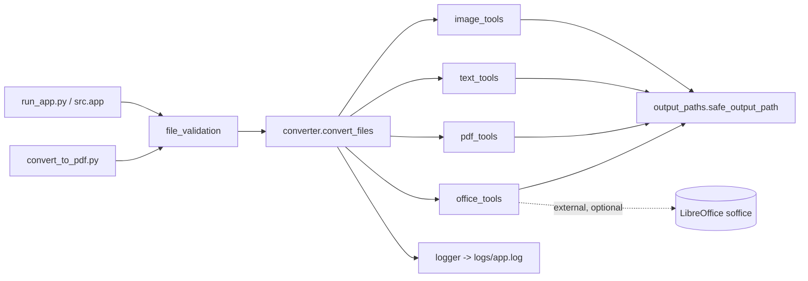

# Fable Full Portfolio Execution Blueprint

## 1 Control+Boundary

| Item | Value |
|---|---|
| Blueprint version | 1.0 |
| Date generated | 2026-07-17 (Asia/Singapore) |
| ROOT (canonical) | `C:\dev\PDF Converter` |
| Initial cwd | `C:\dev\PDF Converter` (identical to ROOT) |
| OS | Windows 11 Home 10.0.26200 |
| Repos | 1 git repo at ROOT, remote `origin = https://github.com/muhammadmirza97/convertToPDF.git` |
| Branches | `main` (HEAD, 683f823), `local-build-backup` (04dd2ed), `origin/main` |
| Environments | `.venv` at `ROOT\.venv`, Python 3.12.10 |
| Path-check method | Every accessed path expressed as ROOT-relative or absolute under `C:\dev\PDF Converter\`; no `..` used; no symlinks/junctions found in project tree; `.venv` inspected read-only (pyvenv.cfg, pip list) |
| Refused paths | None requested outside ROOT. NOTE (C): `.venv\pyvenv.cfg` `command=` line **references** `C:\Users\muham\OneDrive\Desktop\IT Apps\PDF Converter\.venv` (historic creation path). This path was **recorded only, never accessed**. |
| External refs (not accessed) | (1) GitHub remote `convertToPDF` — needed only for push/CI; work possible without it. (2) LibreOffice (`soffice.exe`) — system dependency outside ROOT; detection code reads PATH + `C:\Program Files\...`; not accessed during this audit (app log shows it was sometimes detected, sometimes not — user machine state varies). (3) System Python 3.12.10 install (venv `home=`) — not accessed. |
| Links/mounts/worktrees/submodules | None found (C) |
| Inaccessible items | None inside ROOT |
| Assumptions | `logs/app.log` and `sample_files/generated_pytest/*` content treated as historical evidence, not current verification |
| Generated files | Exactly one: `ROOT\FABLE_FULL_PORTFOLIO_EXECUTION_BLUEPRINT.md` (this file) |
| Mutation proof | No project file created/modified/deleted. Verification commands used `python -B` (no bytecode written) and `pytest --collect-only -p no:cacheprovider` (no cache written). Full `pytest` was **not** run in this pass because it writes `sample_files/generated_pytest/` and `logs/app.log`. |

Inspected paths (all under ROOT): all 32 git-tracked files (`git ls-files` enumerated), plus `.venv/pyvenv.cfg`, `pip list` of `.venv`, `logs/app.log` (tail), `sample_files/` listing, `__pycache__/` listing, `.pytest_cache/` listing.

## 2 Executive

- **Projects found: 1** — "Local PDF Converter" at ROOT itself. The portfolio-plan projects MEDLLM, COMMUTE, LEARNINGTOOL, FLOWERS-102 do **not exist under ROOT** (C); their phase slots in §5 are marked N/A — do not invent them.
- **Strongest**: Local PDF Converter core conversion library (`src/`) — clean service-module separation, 22 collected tests, prior documented QA pass.
- **Weakest / risks**:
  - ENV (P1, C): `requirements.txt` is fully unpinned; a clean install today resolves different versions than the ones the QA report verified.
  - ENV (P1, C): `Dockerfile` `COPY sample_files ./sample_files` fails on a clean clone — `sample_files/` is **not git-tracked** (`git status`: `?? sample_files/`).
  - FUNCTIONAL (P1, C): output-folder *validation* creates directories on disk as a side effect — triggered on **every keystroke** in the GUI output-path field.
  - SECURITY (P1, C): `setup_git.bat` contains `rmdir /s /q .git` — a destructive one-shot script still tracked in the repo.
  - VERIFICATION (U): Office-to-PDF path never verified with a real LibreOffice run; Docker image never built/run in evidence.
- **Active assessment**: none detected in ROOT (no rubric/slides). Treat as portfolio project.
- **Execution order (evidence-based)**: GLOBAL backup → ENV pinning/Docker fix → SECURITY (remove destructive script) → functional fixes → tests/docs → portfolio. Single project, so §5 phases 4–10 collapse into LOCALPDF.
- **Intended final state**: pinned reproducible env; Docker builds from a clean clone; validation is side-effect-free; GUI thread-safe; docs accurate; all 22+ tests pass; Office path verified or explicitly marked manual-blocked; portfolio entry truthful.

## 3 Inventory

**Project LOCALPDF**
- name: Local PDF Converter
- path: ROOT (project root == repo root)
- repo/branch: `convertToPDF` remote; `main` @ 683f823 ("Build and harden Local PDF Converter"); backup branch `local-build-backup` @ 04dd2ed
- purpose: local-only Windows desktop app converting images/TXT/Office↔PDF, merge/split PDFs, PDF→PNG, PDF→text; explicit no-cloud/no-telemetry promise
- users: beginner Windows users (per README); developer: Mirza
- requirements: README + `docs/KNOWN_LIMITATIONS.md` serve as the requirement record; no external rubric found (C)
- state: **Working with known weaknesses** (historical QA report 2026-06-30 claims "22 passed"; this pass verified imports + collection only — full pass is executor's first validation gate)
- stack: Python 3.12.10, customtkinter 6.0.0 (GUI), pymupdf 1.28.0 (render/extract), pypdf 6.14.2 (merge/split/encrypt-detect), pillow 12.2.0 (images), reportlab 5.0.0 (TXT→PDF), pytest 9.1.1; optional external LibreOffice headless
- models/data/APIs/DB/infra: none — pure local file transforms; no network code found (C, grepped source)
- entrypoints: `run_app.py` (GUI), `convert_to_pdf.py` (CLI, auto-action only), `Dockerfile` CMD = `pytest -q`
- current flow: GUI/CLI → `src/file_validation.validate_action` → `src/converter.convert_files` → per-action tool module → `src/output_paths.safe_output_path` (no-overwrite, sanitized) → files in chosen output dir; logging via `src/logger` to `logs/app.log`
- tests+commands: 22 tests in `tests/` (collection verified this pass); `.\.venv\Scripts\python.exe -m pytest -q`
- dependency/env files: `requirements.txt` (7 unpinned names, incl. unused `img2pdf` and dev-only `pytest`); no lockfile; no `.env` (none needed)
- env vars: none used (C)
- deployment: local venv run; optional PyInstaller (`build_exe.ps1`, unverified); Docker for tests only
- outputs: `output/` default dir; `logs/app.log`
- slides/reports/rubrics: `docs/` QA_REPORT, REVIEW_NOTES, SECURITY_REVIEW, CHANGELOG, KNOWN_LIMITATIONS, BUG_REPORT_TEMPLATE (all read; internally consistent with code as of Jun 30)
- strengths: separation of GUI/orchestration/tools; output-name sanitization + containment checks; graceful encrypted-PDF and missing-LibreOffice handling; batch partial-failure isolation; privacy-conscious logging
- weaknesses (C unless noted): unpinned deps; Docker clean-clone break; validation side effect; tk-var reads from worker thread (I); `pdf_to_text` creates output dir before encrypted check; unbounded log file; destructive `setup_git.bat`; README inaccuracies; stray untracked artifacts (`sample_files/_wtest`, `__pycache__/convert_to_pdf.cpython-310.pyc`); venv non-clean origin (I)
- inaccessible parts: real LibreOffice conversion behaviour (system dep absent/variable); Docker runtime not exercised

## 4 Cross-project audit

Single project — no cross-project dependency/duplication conflicts exist (C). Standards to apply here and to future repos placed under a portfolio ROOT:

- Folders: `src/` (package), `tests/`, `docs/`, `output/`+`logs/` gitignored with `.gitkeep`.
- Config: constants in one `config.py`; no magic strings in modules (already satisfied).
- Dependencies: `requirements.txt` pinned `==`; dev tools separated in `requirements-dev.txt`; regenerate with `pip freeze` after any change.
- Tests: pytest; use `pytest.raises` for expected exceptions; never delete/weaken an assertion to make a fix pass.
- Logging: named logger, rotating file handler, no document contents, no full user paths.
- Security: no tracked scripts that delete `.git`; no secrets (none found, C); subprocess always list-args + timeout (already satisfied).
- Deployment: Docker must build from `git ls-files` content only.



## 5 Master plan+tracker

Phases 6–9 of the mandated order (MEDLLM/COMMUTE/LEARNINGTOOL/FLOWERS) are **N/A — projects absent from ROOT** (C). Evidence: full tree enumeration found one repo only.

| Phase | IDs | Entry | Deps | Exit / validation gate | Rollback | Parallel-safe |
|---|---|---|---|---|---|---|
| 1 Boundary/backup | GLOBAL-01 | blueprint read | — | backup branch/tag exists | n/a | — |
| 2 Reproducible env | ENV-01..04 | GLOBAL-01 | — | clean venv installs pinned deps; `pytest -q` 22 passed; Docker builds+runs from clean clone | `git checkout -- requirements.txt Dockerfile` | ENV-02 with ENV-01 |
| 3 Security/privacy | SEC-01, FIX-04 | GLOBAL-01 | — | `setup_git.bat` gone from HEAD; log rotation active | `git revert` | yes |
| 4 Functional fixes | FIX-01..03, FIX-05 | ENV gate passed | ENV-01 | new regression tests pass; all prior tests pass | `git revert` per task | FIX-04/05 parallel |
| 5 Tests+docs | TEST-01..03, DOC-01..02 | Phase 4 | FIX-* | tests green; README commands all literally executable | `git revert` | yes |
| 6 Portfolio+final validation | PORT-01, VAL-* | Phase 5 | all | §10 validation matrix filled with real outputs | n/a | — |

Tracker (executor updates statuses in place):

```
[x] GLOBAL-01  backup branch/tag
[x] ENV-01     pin requirements
[x] ENV-02     remove img2pdf
[x] ENV-03     fix Dockerfile clean-clone break
[?] ENV-04     recreate .venv (manual, optional)
[x] SEC-01     remove setup_git.bat
[ ] FIX-01     side-effect-free output validation
[ ] FIX-02     pdf_to_text validate-before-reserve
[ ] FIX-03     GUI thread-safety + button lock
[ ] FIX-04     log rotation
[ ] FIX-05     CREATE_NO_WINDOW for soffice
[ ] TEST-01    regression tests for FIX-01/02
[ ] DOC-01     README corrections
[?] DOC-02     stray-artifact cleanup (user confirm)
[?] TEST-02    Docker build+run validation
[!] TEST-03    real Office-to-PDF verification (blocked: LibreOffice install is a user action)
[ ] PORT-01    portfolio entry
```

## 6 Per-project audit+implementation — LOCALPDF

### A LOCKS (behaviour that must NOT change)

1. Local-only: no network, cloud API, telemetry, or upload code — ever.
2. Original input files never modified/deleted; outputs never overwrite (numbered `_001` suffixes).
3. Output names sanitized (Windows-invalid chars, reserved device names) and contained inside the chosen output folder.
4. Feature set: image→PDF, images→one PDF, TXT→PDF, merge (≥2), split (blank = per-page; `1-3,5` ranges), PDF→PNG, PDF→text, Office→PDF via LibreOffice only.
5. Missing LibreOffice: app still opens; Office-to-PDF menu item hidden; Auto batch reports per-file Office failures; friendly validation messages.
6. Encrypted PDFs fail gracefully with "Encrypted PDF needs password support".
7. Batch isolation: one file's failure never aborts the batch; summary reports succeeded/failed counts.
8. CLI exit codes: 0 all ok, 1 could-not-start, 2 partial/complete failure.
9. Logs record actions/filenames/output names, never document contents or (for new lines) full paths.
10. Done = all locks hold + all §H validations exit 0.

### B FUNCTIONAL_AUDIT (feature → finding)

| featureID | Feature / entrypoint | Expected vs observed | Defect | Severity |
|---|---|---|---|---|
| F1 | image→PDF (`image_tools.image_to_pdf`) | EXIF transpose, alpha→white, RGB save | none found (C); tests exist | — |
| F2 | images→single PDF (`images_to_single_pdf`) | multi-page append | none found (C) | — |
| F3 | TXT→PDF (`text_tools.txt_to_pdf`) | encoding fallback utf-8/utf-8-sig/cp1252→replace; wraps 90 chars; latin-1 replacement | behaves as documented limitation (C, locked) | — |
| F4 | merge (`pdf_tools.merge_pdfs`) | ≥2 files, encrypted rejected | none found (C) | — |
| F5 | split (`split_pdf`, `parse_page_ranges`) | blank→per page; validates 1..page_count | none found (C); overlaps allowed by design | — |
| F6 | PDF→PNG (`pdf_to_png`) | encrypted checked **before** folder creation | correct (C, fixed in prior pass) | — |
| F7 | PDF→text (`pdf_to_text`) | should validate before touching disk | **DEFECT (C)**: line 113 `safe_output_path(...)` runs `ensure_directory` (mkdir) *before* the encrypted check at line 117 — same bug class previously fixed for F6. Root cause: reservation ordered before validation. Fix: FIX-02. | P2 |
| F8 | Office→PDF (`office_tools.convert_office_to_pdf`) | headless soffice, temp dir in output root, timeout 120s | logic sound (C by reading); **runtime unverified (U)** — no LibreOffice run in evidence. `subprocess.TimeoutExpired` propagates and is caught by batch handler (C). Console flash possible in windowed exe (R → FIX-05). | U / P3 |
| F9 | output-folder validation (`output_paths.is_writable_directory`) | validation must be read-only | **DEFECT (C)**: `ensure_directory` does `mkdir(parents=True)` — validating a path **creates it**. GUI binds `<KeyRelease>` on the output entry → every keystroke of e.g. `C:\Users\muham\D` creates that directory tree + probe file. Root cause: validation reuses the creation helper. Fix: FIX-01. | **P1** |
| F10 | GUI conversion thread (`app._run_conversion`) | tk objects touched only from main thread | **DEFECT (I)**: `self.output_folder.get()`, `self.action.get()`, `self.page_ranges.get()` are called *inside the worker thread*; `self.files` also mutable mid-run because "Select files"/"Output folder" buttons stay enabled during conversion. Works in practice (tkinter Vars are usually tolerant) but is a real race. Fix: FIX-03. | P2 |
| F11 | validation messages / batch isolation (`converter.convert_files`) | per-file try/except, summary counts | correct (C); ValueError→warning, unexpected→exception w/ stack (C) | — |
| F12 | CLI (`convert_to_pdf.py`) | auto-action, exit 0/1/2 | correct (C by reading); no `--action`/`--pages` flags — accepted limitation, do not add without user request (lock 4 scope) | — |
| F13 | logging (`logger.setup_logging`) | append file handler | **WEAKNESS (C)**: no rotation → unbounded `logs/app.log` (already 11.9 KB from light use). Fix: FIX-04. | P3 |

Syntax/imports: verified this pass — `IMPORTS_OK` for all 12 modules; 22 tests collected (C).

### C DESIGN_AUDIT

- Architecture (C, good): thin GUI → orchestration (`converter`) → stateless tool modules → path-safety module. GUI is replaceable; CLI proves it. Keep.
- Issue D1 (C): validation layer (`file_validation`) depends on a *mutating* helper (`output_paths.ensure_directory`) — contract violation ("validate" must not write). Target: `is_writable_directory` becomes read-only probe of the nearest **existing** ancestor; creation stays exclusively in `safe_output_path`/`derived_folder` at conversion time. Migration in FIX-01. Acceptance: calling `validate_action` with a non-existent nested output path leaves the filesystem unchanged.
- Issue D2 (I): GUI state handling — worker thread reads widget Vars (F10). Target: snapshot inputs in `_start_conversion` (main thread), pass as arguments; disable `choose_button` and output-folder button while `is_converting`. Acceptance: grep shows no `.get()` on tk Vars inside `_run_conversion`; buttons disabled during run.
- Issue D3 (C, minor): tests assert exceptions via try/except/else instead of `pytest.raises` (3 places). Target style-only change in TEST-01; assertions must remain equally strict.
- UI states: loading (progress bar + disabled Convert) present; error (messagebox + log box) present; empty (validation message) present. No file-list view (only a count) — recorded as optional P3, not tasked (avoid redesign without benefit).
- Code-doc consistency: README structure list matches `src/` exactly (C). README command examples partially wrong → DOC-01.

### D PIPELINE_AUDIT

Chain (batch, local, synchronous): user file pick → extension+existence validation (`validate_files`) → output-folder validation (`validate_output_folder`) → action compatibility (`validate_action`) → per-file convert (`_convert_single`) → output reservation (`safe_output_path`: sanitize → containment assert → no-overwrite numbering) → write → summary → GUI queue events / CLI prints → log.

| Stage | Component | Failure handling | Status |
|---|---|---|---|
| Input validation | `file_validation` | friendly messages; first-offender reported | implemented (C) |
| Output reservation | `output_paths` | containment `ValueError`; numbered suffixes; race window between `exists()` and write is theoretical single-user risk — accept (I) | implemented (C) |
| Transform | tool modules | per-file isolation; encrypted detection; soffice timeout | implemented (C); F7 ordering defect |
| Service/UI | `app.py` queue drain @100ms | thread → queue → main thread | implemented (C); F10 race |
| Monitoring | `logs/app.log` | INFO/WARNING/EXCEPTION split | implemented (C); no rotation |

No mock/bypassed/hardcoded stages found (C). Primary end-to-end run command (headless, real conversions):
`.\.venv\Scripts\python.exe convert_to_pdf.py "<any .txt or .png under ROOT>" -o output` → expect `Created: ...` + exit 0.

### E REPRO_ENV_AUDIT

- Supported: Windows 10/11, Python 3.12.x (built on 3.12.10, C), pip+venv. GUI needs a display; core+tests run headless (tests never import `src.app`, C).
- Pinned deps: **currently none** (C) → ENV-01 pins to the versions proven in the live venv: `customtkinter==6.0.0, pymupdf==1.28.0, pypdf==6.14.2, pillow==12.2.0, reportlab==5.0.0` (+ dev `pytest==9.1.1`). `img2pdf` (0.6.3) is installed but **never imported anywhere** (C, grep `NO_IMG2PDF_IMPORTS`) → ENV-02 removes it (its transitive deps pikepdf/lxml/charset-normalizer then disappear from clean installs).
- System packages: none for core; LibreOffice optional (PATH or `C:\Program Files\LibreOffice\program\soffice.exe`).
- GPU/CUDA: N/A. Seeds/determinism: N/A (no ML).
- Env vars / secrets / .env: none (C).
- Path assumptions: `config.PROJECT_ROOT = parents of src/` → logs/output default inside ROOT (C). No hidden absolute paths in source (C). `.venv/pyvenv.cfg` records a stale OneDrive creation path; interpreter still functions (C — pip ran) but a clean recreate is recommended (ENV-04, manual optional).
- Docker: Linux `python:3.12-slim`; **build breaks on clean clone** (ENV-03) because `COPY sample_files` targets an untracked dir. Path-sanitization tests were checked for Linux semantics: `Path('..\\bad:name*with?chars')` yields the same sanitized stem on POSIX because the leading dots/underscores are stripped (C by symbolic trace) — no test change needed.
- Clean-machine proof sequence (executor runs after ENV tasks): fresh clone → `python -m venv .venv` → `pip install -r requirements.txt -r requirements-dev.txt` → `pytest -q` (22+ passed) → CLI E2E command above → `docker build -t local-pdf-converter . && docker run --rm local-pdf-converter` → GUI smoke `python -c "from src.app import LocalPDFConverterApp; app=LocalPDFConverterApp(); app.after(200, app.destroy); app.mainloop(); print('GUI_SMOKE_OK')"`.
- Unverified claims: "22 passed" (historical doc), Office conversion, PyInstaller packaging, Docker run — all flagged U until executor validates.

### F CURRENT+TARGET

Implemented: everything in §B marked C. Missing/target deltas only:

| Area | Current | Target |
|---|---|---|
| `requirements.txt` | 7 unpinned names incl. img2pdf+pytest | 5 pinned runtime deps |
| `requirements-dev.txt` | absent | `pytest==9.1.1` |
| `Dockerfile` | copies untracked `sample_files`; installs single requirements file | no sample_files COPY; installs both req files |
| `output_paths.is_writable_directory` | creates dirs | read-only check (spec in FIX-01) |
| `pdf_tools.pdf_to_text` | reserves path then validates | validates then reserves |
| `app.py` conversion start | worker thread reads tk Vars; pick-buttons live during run | main-thread snapshot; buttons disabled |
| `logger.py` | `FileHandler` | `RotatingFileHandler(1 MB, 3 backups)` |
| `setup_git.bat` | tracked destructive script | removed from repo |
| README | 3 inaccuracies | corrected (DOC-01) |

No planned/mock components exist or are introduced.

### G TASKS

Common fields unless overridden: project=LOCALPDF, status=[ ], behaviourPreserved=yes (locks §A), rollback=`git revert <commit>` (one commit per task), manualAction=none.

**GLOBAL-01** P1 — action:preserve. Before any edit: `git branch backup/pre-blueprint-20260717` and `git tag pre-blueprint-20260717`. Success: both listed by `git branch`/`git tag`.

**ENV-01** P1 C — edit `requirements.txt`. Evidence: file has no versions; live venv versions captured in §E. Target content exactly:
```
customtkinter==6.0.0
pymupdf==1.28.0
pypdf==6.14.2
pillow==12.2.0
reportlab==5.0.0
```
Also create `requirements-dev.txt`:
```
-r requirements.txt
pytest==9.1.1
```
Edit `Dockerfile` line 5-7 to copy+install both files (`COPY requirements.txt requirements-dev.txt .` / `pip install --no-cache-dir -r requirements-dev.txt`). Update README install command to include `-r requirements-dev.txt`. Tests: fresh venv install exits 0; `pip check` clean; `pytest -q` all pass. Failure mode: a pin unavailable for the platform → keep the resolvable nearest patch version and record the substitution in the tracker (do not silently unpin).

**ENV-02** P2 C — part of the same `requirements.txt` edit: `img2pdf` omitted (grep-verified unused; deps=ENV-01). Validation: `grep -rn img2pdf src tests *.py` → no hits; tests pass in a fresh venv without it.

**ENV-03** P1 C — edit `Dockerfile`: **delete** line `COPY sample_files ./sample_files`. Evidence: `git ls-files` contains no `sample_files/` entry, so clean-clone builds fail at that COPY; `tests/conftest.py` creates `sample_files/generated_pytest/...` itself with `mkdir(parents=True)` (C), so nothing else is needed. Validation: TEST-02.

**ENV-04** P3 I — [?] manual, optional: user deletes and recreates `.venv` in-place (`python -m venv .venv` from ROOT) to clear the stale OneDrive `command=` record. Blocked work: none; independent work continues.

**SEC-01** P1 C — action:remove `setup_git.bat` (`git rm setup_git.bat`). Evidence: lines 6-7 `if exist .git rmdir /s /q .git` — re-running it destroys history; its one-time purpose (initial repo link) is complete (remote exists, 4 commits). AffectedCallers: none (nothing references it, C). Validation: file absent from HEAD; `git log` intact. Rollback: `git revert`.

**FIX-01** P1 C — edit `src/output_paths.py` + `src/file_validation.py`. Symbol: `is_writable_directory`. Current: `ensure_directory(path)` (mkdir!) then probe-write. Target signature unchanged `is_writable_directory(path: str | Path) -> bool`, new contract: **no filesystem mutation when the directory does not exist**. Exact logic:
```python
def is_writable_directory(path: str | Path) -> bool:
    try:
        target = Path(path).expanduser().resolve()
    except OSError:
        return False
    probe_dir = target
    while not probe_dir.exists():
        parent = probe_dir.parent
        if parent == probe_dir:          # drive root missing
            return False
        probe_dir = parent
    if not probe_dir.is_dir():           # nearest existing ancestor is a file
        return False
    return os.access(probe_dir, os.W_OK)
```
Add `import os`. Note: `os.access` on Windows is approximate for ACLs; acceptable because `safe_output_path`→`ensure_directory` still raises at conversion time and `converter` reports it as a friendly failure (existing path, C). Keep `ensure_directory` itself unchanged (creation at conversion time is correct). AffectedCallers: `validate_output_folder` (message "The output folder is not writable." unchanged), GUI keystroke validation. Preserved behaviours: existing-file-as-folder still returns False (`probe_dir.is_dir()` False — keeps `test_output_folder_rejects_existing_file_path` green). Tests: TEST-01 X1/X2.

**FIX-02** P2 C — edit `src/pdf_tools.py::pdf_to_text`. Move `output_path = safe_output_path(output_dir, source.stem, ".txt")` from before `fitz.open` to after the `needs_pass` check succeeds (i.e., first statement after the encryption guard, still inside the `with` block, before the page loop). Contract/signature unchanged. Acceptance: encrypted-PDF call leaves a previously non-existent output directory uncreated (TEST-01 X3).

**FIX-03** P2 I — edit `src/app.py`. In `_start_conversion` (main thread) snapshot: `files=list(self.files)`, `output=self.output_folder.get()`, `action=self.action.get()`, `pages=self.page_ranges.get().strip() or None`; pass via `threading.Thread(target=self._run_conversion, args=(files, output, action, pages), daemon=True)`. New signature `_run_conversion(self, files, output, action, pages)` using only those locals + `self.event_queue`. Also: disable `self.choose_button` and the output-folder button while converting; re-enable in `_finish_conversion`/`_fail_conversion` (store the output button as `self.output_button` — it is currently a local variable `output_button` in `_build_ui`, promote it to an attribute). Validation: GUI smoke passes; grep confirms no tk `.get()` inside `_run_conversion`.

**FIX-04** P3 C — edit `src/logger.py`: replace `logging.FileHandler` with `logging.handlers.RotatingFileHandler(log_dir / "app.log", maxBytes=1_000_000, backupCount=3, encoding="utf-8")`; import `logging.handlers`. Same format/level. Validation: import check + tests pass; log still written.

**FIX-05** P3 R — edit `src/office_tools.py::convert_office_to_pdf`: add `creationflags=subprocess.CREATE_NO_WINDOW if os.name == "nt" else 0` to `subprocess.run` (import `os`). Prevents console flash under `--windowed` PyInstaller builds. No behaviour change otherwise. Validation: [?] real run needs LibreOffice (TEST-03); until then, import check + unchanged tests.

**TEST-01** P2 — edit/create tests (never weaken existing ones):
- X1 `tests/test_output_paths.py::test_is_writable_directory_does_not_create_missing_dirs`: input `workspace / "no" / "such" / "nested"`; call `is_writable_directory`; assert return is `True` (parent chain writable) **and** `not (workspace / "no").exists()`.
- X2 `tests/test_file_validation.py::test_validate_output_folder_has_no_side_effects`: `validate_action` with a valid txt input and output folder `workspace / "typed" / "partial"`; assert `(workspace / "typed")` does not exist afterwards.
- X3 `tests/test_pdf_tools.py::test_encrypted_pdf_text_does_not_create_output_dir`: reuse encrypted-PDF fixture code from `test_encrypted_pdf_fails_gracefully`, output dir `workspace / "fresh_out"`; expect `ValueError` and `not (workspace / "fresh_out").exists()`.
- Style: convert the 3 try/except/else exception asserts to `pytest.raises(ValueError, match=...)` with the **same** message substrings ("numbers", "Encrypted PDF", "LibreOffice").
mocksAllowed: `monkeypatch` of `find_libreoffice` only (existing pattern). mocksForbidden: any mock of conversion outputs. Command: `.\.venv\Scripts\python.exe -m pytest -q` → 25+ passed, exit 0.

**DOC-01** P2 C — edit `README.md`:
1. Line 45 example uses `sample_files\example.txt` which does not exist (C) → replace with an instruction to point at any local `.txt` file, e.g. `.\.venv\Scripts\python.exe convert_to_pdf.py "C:\path\to\your\notes.txt" -o output`.
2. Docker section: `docker build` alone does not run tests (CMD runs at container start, C) → add `docker run --rm local-pdf-converter` as the test step.
3. Install section: add `-r requirements-dev.txt` (after ENV-01).
Everything else preserved verbatim.

**DOC-02** P3 C — [?] user-confirm cleanup of untracked junk (deletion needs owner sign-off, not executor initiative): `sample_files/_wtest` (0-byte stray), `__pycache__/convert_to_pdf.cpython-310.pyc` (stale Python 3.10 artifact from a pre-repo version). Neither is git-tracked; removing them changes nothing functional.

**TEST-02** P2 U — [?] validate Docker: `docker build -t local-pdf-converter .` then `docker run --rm local-pdf-converter`; expected: image builds, container prints `22 passed`-style summary (25+ after TEST-01), exit 0. Prereq: Docker Desktop present (availability unknown, U). If absent: mark [!] with blocker "Docker not installed", continue other tasks.

**TEST-03** P2 U — [!] real Office-to-PDF verification. Blocker: LibreOffice is a system install the user must perform (external to ROOT; logs show it was detected on 2026-06-30 13:57 but not on later runs — machine state varies, C). Manual steps once installed: run GUI, convert one real `.docx`; expect a text-matching PDF in `output/`; record result in validation matrix. Independent work: everything else.

**PORT-01** P3 — create nothing new in-repo beyond README accuracy; portfolio content specified in §8.

### H TEST+VALIDATE (command records)

All commands: OS=Windows 11, shell=PowerShell, workingDir=ROOT, prereq=`.venv` exists (or fresh per V1).

| C-id | Purpose | Command | Expected exit/output | Mutations (all in-ROOT) |
|---|---|---|---|---|
| V1 | clean env install | `python -m venv .venv; .\.venv\Scripts\python.exe -m pip install -r requirements.txt -r requirements-dev.txt` | exit 0 | `.venv/` |
| V2 | dep integrity | `.\.venv\Scripts\python.exe -m pip check` | "No broken requirements found." | none |
| V3 | unit/integration | `.\.venv\Scripts\python.exe -m pytest -q` | exit 0, 25+ passed (22 pre-TEST-01) | `sample_files/generated_pytest/`, `logs/app.log` |
| V4 | compile check | `.\.venv\Scripts\python.exe -m compileall -q src run_app.py convert_to_pdf.py tests` | exit 0, no output | `__pycache__/` |
| V5 | CLI E2E (real pipeline) | `.\.venv\Scripts\python.exe convert_to_pdf.py "<in-ROOT .txt>" -o output` | exit 0, `Created: ...pdf` | `output/*.pdf`, log |
| V6 | GUI smoke | `.\.venv\Scripts\python.exe -c "from src.app import LocalPDFConverterApp; app=LocalPDFConverterApp(); app.after(200, app.destroy); app.mainloop(); print('GUI_SMOKE_OK')"` | `GUI_SMOKE_OK` | log |
| V7 | Docker | `docker build -t local-pdf-converter .` + `docker run --rm local-pdf-converter` | build ok; tests pass in container | Docker image (engine-managed) |
| V8 | no secrets | `git grep -iE "password=|api_key|secret_key|token=" -- ':!FABLE_FULL_PORTFOLIO_EXECUTION_BLUEPRINT.md'` | no credential hits (encrypt("secret") in tests is a test fixture, allowed) | none |
| V9 | Office real run | manual (TEST-03) | PDF produced | output/ |

Common failure/recovery: V3 failing after a FIX task → do **not** edit the test; `git revert` the fix commit and re-diagnose.

### I ACCEPT+ROLLBACK

Accept LOCALPDF only when: V1–V6 + V8 exit clean on the pinned env; V7 clean or [!]-documented; no lock (§A) regression; README commands literally reproducible; tracker fully updated. Rollback layers: per-task `git revert`; whole-effort `git checkout backup/pre-blueprint-20260717`; no DB/model/migration rollback applies. Manual actions limited to ENV-04, DOC-02, TEST-02/03 with reasons stated above.

## 7 Domain rules

ML/DL/LLM/MEDLLM/COMMUTE/LEARNINGTOOL rules: **not applicable** — no ML models, training, datasets, APIs, DBs, Kafka, or Airflow exist in ROOT (C). No metrics exist to report; none may be invented. Timezone handling: log timestamps are local machine time; acceptable for a local desktop tool (no cross-zone requirement).

## 8 Security+docs+portfolio

Security audit (file-level, all C):

| Risk | Severity | Evidence/path | Mitigation | Validation |
|---|---|---|---|---|
| R1 destructive tracked script | P1 | `setup_git.bat:6-7` deletes `.git` | SEC-01 remove | file absent in HEAD |
| R2 validation writes to arbitrary typed paths | P1 | `output_paths.py:36-51` + `app.py:80` keybinding | FIX-01 | TEST-01 X1/X2 |
| R3 unpinned deps (supply drift) | P1 | `requirements.txt` | ENV-01 | V1/V2 |
| R4 unbounded log growth | P3 | `logger.py:19` | FIX-04 | rotation observed |
| Secrets/.env/credentials | none found | full tracked-file read + V8 grep | — | V8 |
| Injection | none | subprocess uses list args, `shell=False`, timeout (`office_tools.py:55-61`); no SQL/eval/pickle | preserve | code review |
| Path traversal | mitigated | `sanitize_base_name` + `_assert_inside_directory` + tests | preserve | existing tests |
| Git history secrets | U (not scanned) | — | executor: `git log -p --all \| Select-String -Pattern "api_key","password="` (read-only) | no hits |
| Docker | low | test-only image; no ports/volumes/secrets | ENV-03 only | V7 |
| Logs privacy | ok for new lines | historical pre-hardening lines may hold full paths (`docs/SECURITY_REVIEW.md` notes this) | optional user log clear (manual) | — |

README plan: preserve everything except the three DOC-01 corrections (rewrite those lines only). `docs/*` preserved as historical records; add one CHANGELOG entry describing this blueprint's executed changes (append-only).

Portfolio entry (truthful, no exaggeration):
- Problem+solution (1 sentence): "People shouldn't upload private documents to random websites just to convert them, so I built a fully offline Windows PDF converter."
- User: privacy-conscious Windows users. Stack: Python 3.12, CustomTkinter, PyMuPDF, pypdf, Pillow, ReportLab, optional LibreOffice headless, pytest, Docker (tests).
- AI/ML contribution: none — position as software-engineering/QA evidence, not ML.
- Strongest achievement: hardened file-safety layer (sanitization, containment, no-overwrite) with regression tests.
- Verified result: state only what the validation matrix records at execution time (currently: 22 tests collected, imports clean, prior documented 22-pass QA).
- Reliability feature: batch partial-failure isolation + graceful encrypted-PDF/missing-LibreOffice handling.
- Challenge to narrate: discovering that "validate" quietly created directories on every keystroke — a lesson in side-effect-free contracts.
- Limitation: no OCR, no PDF passwords, Office path depends on LibreOffice. Next improvement: rotation/compression, password entry.
- Interview Q&A prep: why subprocess list-args, why containment check, why queue between worker thread and tkinter.
- Screenshots/demo: GUI main window + a merge/split run (user captures; none exist in repo).

## 9 Fallbacks

Registered fallbacks (all pre-existing, visible, non-silent — keep):
- FB1 TXT encoding: utf-8 → utf-8-sig → cp1252 → utf-8-with-replacement (`text_tools._read_text`). Difference from real: replacement chars possible; documented in KNOWN_LIMITATIONS. Visible via output content. Keep.
- FB2 Latin-1 glyph replacement in TXT→PDF (`text_tools.py:50`). Documented limitation. Keep.
- FB3 Missing LibreOffice: feature hidden + friendly validation message — a visible degradation, not a mock. Keep.
No silent mocks, fake APIs, or fabricated metrics exist (C); none may be added. Test-only mock: `monkeypatch` of `find_libreoffice` (allowed, tests only).

## 10 Final outputs inside blueprint

Validation matrix (executor fills `actual`):

| project | valID | env | stage | command | expected | actual | status | blocker |
|---|---|---|---|---|---|---|---|---|
| LOCALPDF | V1 | fresh venv | install | §H V1 | exit 0 | — | [ ] | — |
| LOCALPDF | V2 | venv | deps | §H V2 | no broken reqs | — | [ ] | — |
| LOCALPDF | V3 | venv | unit/integration | §H V3 | 25+ passed | — | [ ] | — |
| LOCALPDF | V4 | venv | compile | §H V4 | exit 0 | — | [ ] | — |
| LOCALPDF | V5 | venv | E2E pipeline | §H V5 | Created: *.pdf | — | [ ] | — |
| LOCALPDF | V6 | venv+display | UI smoke | §H V6 | GUI_SMOKE_OK | — | [ ] | — |
| LOCALPDF | V7 | Docker | container tests | §H V7 | tests pass | — | [?] | Docker availability U |
| LOCALPDF | V8 | repo | security grep | §H V8 | no hits | — | [ ] | — |
| LOCALPDF | V9 | manual | Office real run | §H V9 | PDF output | — | [!] | LibreOffice user install |

Readiness matrix:

| project | state | strongest skill | weakest area | role relevance | repro | functional | pipeline | design | deploy | presentation | portfolio value | next |
|---|---|---|---|---|---|---|---|---|---|---|---|---|
| LOCALPDF | Working w/ known weaknesses | defensive file handling + tests | env pinning / unverified Office+Docker | SWE/QA (not ML) | medium→high after ENV | high | high (local) | good | venv+Docker(tests) | README solid after DOC-01 | medium | execute tracker |

Final boundary proof: every path read or listed in this audit resolves under `C:\dev\PDF Converter\`; the sole recorded external strings (GitHub URL, LibreOffice paths, stale OneDrive path inside `pyvenv.cfg`, system Python home) were **recorded from in-ROOT file contents and never accessed**; the only file created is this blueprint at ROOT; no project file was modified (verifiable: `git status` shows only `?? sample_files/` pre-existing plus this new untracked `.md`).

---

### Smaller-model operating prompt (copy verbatim to the executor)

You are the executor for `C:\dev\PDF Converter` (ROOT). Rules:
1. Never read, write, or list anything outside ROOT; never use `..`; resolve every path first; store all temp/log/output data inside ROOT.
2. Read `FABLE_FULL_PORTFOLIO_EXECUTION_BLUEPRINT.md` fully before acting. It is the single source of truth; do not redesign.
3. Execute tasks in tracker order (§5): GLOBAL-01 → ENV-01/02 → ENV-03 → SEC-01 → FIX-01 → FIX-02 → FIX-03 → FIX-04 → FIX-05 → TEST-01 → DOC-01 → TEST-02 → PORT-01. One task = one commit = one tracker status update ([ ]→[~]→[x]/[!]/[F], with [?] for manual items).
4. Preserve every LOCK in §6A. Never change GUI wording, action names, output-naming, exit codes, or validation messages except where a task explicitly states the exact new text.
5. Follow the exact code specs in §6G — signatures, logic blocks, file paths, and pinned versions are decisions already made; do not substitute.
6. Never weaken, delete, or loosen a test to make something pass. If a validation fails, revert the causing commit and report the failure verbatim.
7. Run the §H validation commands after each phase gate and paste real output into the §10 validation matrix `actual` column. Never invent or summarize results as "passed" without the actual command output.
8. No silent mocks or fallbacks. Mocks only in tests via the existing `monkeypatch` pattern.
9. If blocked (Docker missing, LibreOffice missing), mark the task [!] with the exact blocker string and continue with independent tasks.
10. Distinguish in every report: verified (command output shown) / partial / blocked / failed. Report after completing the project with: tasks done, files touched, commands run, validation matrix state, remaining blockers.
